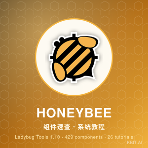
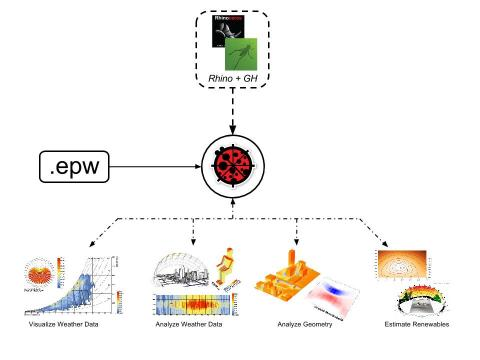
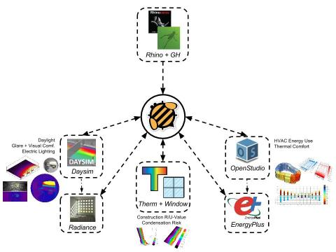

<div align="center">


# Honeybee 组件速查与系统教程
### Honeybee Component Reference & Tutorials

**把 Ladybug Tools 的 429 个组件，做成查得到、看得懂、学得会的中英双语手册。**
**All 429 Ladybug Tools components — searchable, explained, and taught in Chinese and English.**

[](https://www.kbitai.com.cn/resources/AC_Tutorial/honeybee/site/index.html)
[](https://www.ladybug.tools/)
[](#组件总览--component-matrix)
[](#教程目录--tutorial-contents)
[](#功能特性--features)
[](#图标与双语实现--icons--i18n)
[](#许可与致谢--license--credits)

[在线站点 Live](https://www.kbitai.com.cn/resources/AC_Tutorial/honeybee/site/index.html)　·　[快速开始](#快速开始--quick-start)　·　[功能特性](#功能特性--features)　·　[教程目录](#教程目录--tutorial-contents)　·　[目录结构](#目录结构--structure)　·　[数据流水线](#数据流水线--data-pipeline)　·　[维护约定](#维护约定--maintenance)

</div>

<div align="center">

</div>

---

## 简介 · Overview

**中文** — 这是一套面向中文用户的 Ladybug Tools 学习资料。Rhino / Grasshopper 里的 Ladybug、Honeybee、HB-Energy、HB-Radiance 四个标签页共 **429 个组件**，全部整理成可全文搜索的速查手册：每个组件配矢量图标、中英名称、全量输入输出端口与中文要点，并链接到 **22 篇系统教程**、**4 个附录** 与 **117 条术语表**。界面默认中文，右上角「中 / EN」一键切换，所有文案、端口说明、教程正文实时生效并记住你的选择。

**English** — A bilingual learning resource for Ladybug Tools. All **429 components** across the Ladybug, Honeybee, HB-Energy and HB-Radiance tabs are catalogued in a full-text searchable reference: vector icon, Chinese and English names, every input/output port with Chinese key points, linked to **22 tutorials**, **4 appendices** and a **117-term glossary**. The UI starts in Chinese; the 中 / EN switch flips chrome, port notes and articles instantly and remembers the choice.

| | 中文 | English |
|---|---|---|
| **定位** | 工程人写的组件手册，不堆概念，直接告诉你这个端口要填什么 | A practitioner's handbook: what goes into this port, not just what it is called |
| **对象** | 建筑性能分析初学者、在校生、方案阶段做能耗/采光校核的设计师 | Beginners, students and designers checking energy or daylight during concept design |
| **来源** | 官方 `lbt-grasshopper 1.10.6` 组件档案与 docstring，非二手转述 | Official `lbt-grasshopper 1.10.6` archives and docstrings, not second-hand summaries |
| **形态** | 纯静态站，零依赖、零构建、可离线部署 | A zero-dependency static site that builds nothing and runs anywhere |

---

## 功能特性 · Features

| 能力 Capability | 中文说明 | English |
|---|---|---|
| **组件速查** | 429 条，按 4 个标签页、23 个子分类组织；中英名、昵称、端口名、说明全文搜索 | 429 entries in 4 tabs and 23 sub-categories; full-text search over names, nicknames, ports and descriptions |
| **矢量图标** | 原厂 24px PNG 经透明感知放大与多边形描摹为 SVG，色块交界硬边、无虚边薄层，PNG 自动回退 | Native 24px PNGs upscaled with alpha awareness and traced to SVG with hard colour borders; PNG fallback |
| **端口表** | 名称、类型、是否必填、中文要点（单位 / 默认值 / 范围 / 枚举），可展开「中文说明 + 英文原文」 | Port name, type, required flag, Chinese key points (unit / default / range / enum), collapsible notes with the English source |
| **中英双语** | 顶栏「中 / EN」，界面、侧栏、计数、弹窗、端口说明、教程正文全部实时切换 | 中 / EN in the header switches chrome, sidebar, counts, modal, port notes and articles instantly |
| **系统教程** | 入门 → 气象 → 建模 → 能量 → 采光 → 实战，22 篇正文 + 4 个附录，正文可单独切换语言 | 22 chapters from fundamentals to energy and daylight, plus 4 appendices; each article switches language on its own |
| **术语表** | 117 条中英对照，覆盖 EPW、构造、采光指标、HVAC 等 | 117 bilingual terms covering EPW, constructions, daylight metrics, HVAC and more |
| **明暗主题** | 跟随系统，可手动切换并记忆；打印友好；移动端自适应 | Follows the system, remembers manual choice, print-friendly, responsive |
| **教学视频** | 相关章节内附 B 站视频链接，国内可直达 | Selected chapters link to Bilibili videos reachable from mainland China |

<div align="center">

| 组件速查 | 教程阅读 |
|---|---|
|  |  |
| 教程插图：Rhino 界面与数据流 | 教程插图：案例项目总览 |

</div>

---

## 快速开始 · Quick Start

**中文** — 站点运行时会 `fetch` 读取 JSON，必须通过 HTTP 服务打开，直接双击 `index.html` 会被浏览器的同源策略拦截。

**English** — The site fetches JSON at runtime, so serve the folder over HTTP; double-clicking `index.html` will be blocked by the browser.

```bash
git clone https://github.com/archilau0315/Honeybee_Tutorial.git
cd Honeybee_Tutorial
python -m http.server 8080
# 打开 / open: http://localhost:8080/site/index.html
```

**快捷键 Shortcuts**

| 按键 Key | 作用 Action |
|---|---|
| <kbd>/</kbd> | 聚焦搜索框 · focus the search box |
| <kbd>Esc</kbd> | 清空搜索或关闭详情弹窗 · clear search or close the detail modal |
| <kbd>中</kbd> / <kbd>EN</kbd> | 切换界面语言 · switch interface language |
| <kbd>◐</kbd> | 切换明暗主题 · toggle theme |

**运行环境 Requirements**：任意现代浏览器；本地预览只需 Python 3（或任何静态服务器）。无需 Node、无需安装依赖、无需构建。
Any modern browser; Python 3 (or any static server) for local preview. No Node, no dependencies, no build step.

---

## 技术栈 · Tech Stack

| 层 Layer | 实现 Implementation | 说明 Notes |
|---|---|---|
| 前端 Frontend | 原生 HTML / CSS / JavaScript | 零框架、零构建、零运行时依赖 · no framework, no bundler, no runtime deps |
| 数据 Data | JSON（组件、分类、章节、术语、端口译名） | 页面按需加载，独立于代码更新 · loaded on demand, updated independently |
| 图标 Icons | SVG（vtracer polygon 描摹）+ PNG 回退 | 288×288 viewBox，直边无外鼓 · straight segments, no bulge |
| 流水线 Pipeline | Python 3（`tools/`） | `.ghuser` 解析 → 译名合并 → 校验 · parse, merge, validate |
| 部署 Deploy | 静态文件 + 阿里云 Nginx | 上传即生效 · rsync/scp and it is live |

---

## 组件总览 · Component Matrix

**中文** — 四个标签页的组件规模、子分类数量与对应教程章号。

**English** — Component counts, sub-categories and the matching tutorial chapters per tab.

| 标签页 Tab | 组件 Components | 子分类 Sub-categories | 教程章节 Chapters |
|---|---:|---:|---|
| Ladybug | 122 | 6 | 04–07 |
| Honeybee | 70 | 4 | 08–12 |
| HB-Energy | 143 | 8 | 13–17 |
| HB-Radiance | 94 | 5 | 18–20 |
| **合计 Total** | **429** | **23** | **22 章 + 4 附录** |

<details>
<summary><b>数据体量 · Data at a glance</b></summary>

| 文件 File | 内容 Content | 规模 Size |
|---|---|---|
| `data/components.json` | 组件、端口、中英说明 | 429 条 |
| `data/categories.json` | 标签页与子分类树 | 4 标签页 / 23 子分类 |
| `data/chapters.json` | 教程与附录清单 | 22 + 4 |
| `data/terms.json` | 中英术语 | 117 条 |
| `data/port_i18n.json` | 端口名中文译名 | 1504 条 |
| `assets/icons/svg/` | 矢量图标 | 429 个 |
| `assets/icons/{24,48,96}/` | 原厂 PNG 回退 | 429 × 3 张 |

</details>

---

## 教程目录 · Tutorial Contents

**中文** — 22 篇教程按学习路径分为 6 个部分，另附 4 个附录，共 26 篇文档，每篇均为中英对照。点击文件名可直接阅读 Markdown 原文。

**English** — 22 chapters in six parts plus four appendices — 26 documents in total, each in Chinese and English. File names link to the Markdown source.

<details open>
<summary><b>Part 0 · 入门 Getting Started</b></summary>

| # | 章节 Chapter | 中文 | English |
|---|---|---|---|
| 01 | `01-what-is-lbt` | [Ladybug Tools 是什么](doc/zh/01-what-is-lbt.md) | [What Ladybug Tools Is](doc/en/01-what-is-lbt.md) |
| 02 | `02-install` | [安装与自检](doc/zh/02-install.md) | [Install and Verify](doc/en/02-install.md) |
| 03 | `03-interface` | [界面与数据流](doc/zh/03-interface.md) | [Interface and Data Flow](doc/en/03-interface.md) |

</details>

<details>
<summary><b>Part 1 · 气象与环境数据 Weather and Environment</b></summary>

| # | 章节 Chapter | 中文 | English |
|---|---|---|---|
| 04 | `04-weather` | [天气数据与站点](doc/zh/04-weather.md) | [Weather Data and Sites](doc/en/04-weather.md) |
| 05 | `05-sun-sky` | [太阳、天空与阴影](doc/zh/05-sun-sky.md) | [Sun, Sky and Shadows](doc/en/05-sun-sky.md) |
| 06 | `06-data-analysis` | [数据分析与图表](doc/zh/06-data-analysis.md) | [Data Analysis and Charts](doc/en/06-data-analysis.md) |
| 07 | `07-comfort-visualize` | [舒适度与可视化表达](doc/zh/07-comfort-visualize.md) | [Comfort and Visualization](doc/en/07-comfort-visualize.md) |

</details>

<details>
<summary><b>Part 2 · 建模 Modeling</b></summary>

| # | 章节 Chapter | 中文 | English |
|---|---|---|---|
| 08 | `08-first-model` | [建出第一个模型](doc/zh/08-first-model.md) | [Build Your First Model](doc/en/08-first-model.md) |
| 09 | `09-clean-model` | [模型整理与合法性](doc/zh/09-clean-model.md) | [Clean and Validate the Model](doc/en/09-clean-model.md) |
| 10 | `10-batch-generate` | [批量生成与参数化](doc/zh/10-batch-generate.md) | [Batch Generation and Parametrics](doc/en/10-batch-generate.md) |
| 11 | `11-inspect-visualize` | [属性查看与图面表达](doc/zh/11-inspect-visualize.md) | [Inspection and Display](doc/en/11-inspect-visualize.md) |
| 12 | `12-serialize-exchange` | [拆分、重组与文件交换](doc/zh/12-serialize-exchange.md) | [Serialize and Exchange](doc/en/12-serialize-exchange.md) |

</details>

<details>
<summary><b>Part 3 · 能量 Energy</b></summary>

| # | 章节 Chapter | 中文 | English |
|---|---|---|---|
| 13 | `13-materials-constructions` | [材料与构造三步法](doc/zh/13-materials-constructions.md) | [Materials and Constructions](doc/en/13-materials-constructions.md) |
| 14 | `14-schedules-loads` | [运行计划、负荷与内扰](doc/zh/14-schedules-loads.md) | [Schedules, Loads and Gains](doc/en/14-schedules-loads.md) |
| 15 | `15-hvac` | [HVAC 与生活热水](doc/zh/15-hvac.md) | [HVAC and Hot Water](doc/en/15-hvac.md) |
| 16 | `16-simulation` | [模拟设置与运行](doc/zh/16-simulation.md) | [Simulation Setup and Run](doc/en/16-simulation.md) |
| 17 | `17-results` | [读结果与看图](doc/zh/17-results.md) | [Reading Results](doc/en/17-results.md) |

</details>

<details>
<summary><b>Part 4 · 采光 Daylight</b></summary>

| # | 章节 Chapter | 中文 | English |
|---|---|---|---|
| 18 | `18-radiance-materials-sky` | [Radiance 材质与天空](doc/zh/18-radiance-materials-sky.md) | [Radiance Materials and Skies](doc/en/18-radiance-materials-sky.md) |
| 19 | `19-sensor-grids-views` | [传感器网格与视图](doc/zh/19-sensor-grids-views.md) | [Sensor Grids and Views](doc/en/19-sensor-grids-views.md) |
| 20 | `20-daylight-metrics` | [采光指标与模拟](doc/zh/20-daylight-metrics.md) | [Daylight Metrics and Simulation](doc/en/20-daylight-metrics.md) |

</details>

<details>
<summary><b>Part 5 · 实战与排查 Practice and Troubleshooting</b></summary>

| # | 章节 Chapter | 中文 | English |
|---|---|---|---|
| 21 | `21-case-study` | [完整案例：一间办公室的采光 + 能耗](doc/zh/21-case-study.md) | [Case Study: Office Daylight and Energy](doc/en/21-case-study.md) |
| 22 | `22-troubleshooting` | [排错手册与检查清单](doc/zh/22-troubleshooting.md) | [Troubleshooting and Checklist](doc/en/22-troubleshooting.md) |

</details>

<details>
<summary><b>附录 Appendix</b></summary>

| # | 附录 Appendix | 中文 | English |
|---|---|---|---|
| A | `a-terms` | [术语表](doc/zh/a-terms.md) | [Glossary](doc/en/a-terms.md) |
| B | `b-index` | [组件全索引](doc/zh/b-index.md) | [Component Index](doc/en/b-index.md) |
| C | `c-hbjson` | [HBJSON 数据字典](doc/zh/c-hbjson.md) | [HBJSON Dictionary](doc/en/c-hbjson.md) |
| D | `d-version-license` | [版本对照与许可](doc/zh/d-version-license.md) | [Versions and License](doc/en/d-version-license.md) |

</details>

---

## 目录结构 · Structure

```text
Honeybee_Tutorial/
├── readme.md                    本文档 · this file
├── 开发计划.md                  开发计划 · project plan
├── debug_log_1.md               变更记录 · change log
├── cover.svg                    封面 / 资源页卡片缩略图
├── site/                        静态站点
│   ├── index.html               页面骨架 · page shell
│   ├── app.js                   视图、搜索、卡片、弹窗
│   ├── util.js                  端口解析与极简 Markdown 渲染
│   ├── i18n.js                  界面中英字典
│   └── style.css                主题、布局、响应式
├── assets/
│   ├── icons/svg/               429 个矢量图标（主用）
│   ├── icons/{24,48,96}/        429 × 3 张原厂 PNG（回退）
│   ├── brand/                   蜜蜂站标与 favicon
│   └── shots/                   教程配图
├── data/
│   ├── components.json          429 条组件数据
│   ├── categories.json          4 标签页 / 23 子分类
│   ├── chapters.json            22 篇教程 + 4 附录
│   ├── terms.json               117 条术语
│   ├── port_i18n.json           1504 个端口中文译名
│   ├── raw_components.json      解析中间产物
│   └── zh_*.json                人工中文译名表（4 份）
├── doc/zh|en/                   26 篇中英 Markdown（各一套，含附录）
├── tools/                       数据流水线脚本
└── reports/                     构建报告（图标缺失清单）
```

---

## 数据流水线 · Data Pipeline

**中文** — 所有数据来自本机安装的官方 Python 包（`ladybug_grasshopper`、`honeybee_grasshopper_core`、`-energy`、`-radiance`）。`.ghuser` 是 raw deflate 压缩的 GH 二进制档案，解压后可读出名称、分类、说明与内嵌 PNG；端口说明取自同名 `src/*.py` 的 docstring。**官方英文原文不改写，中文为人工校订。**

**English** — Everything derives from the locally installed official packages. A `.ghuser` is a raw-deflate GH archive holding name, category, description and an embedded PNG icon; port notes come from the matching `src/*.py` docstring. **Official English wording is preserved verbatim; Chinese is human-reviewed.**

```text
.ghuser + src/*.py
        │  parse_components.py
        ▼
raw_components.json ──► build_data.py ──► components.json / categories.json
        │                    ▲
        │                    └── data/zh_*.json（人工译名）
        ▼
build_port_i18n.py ──► port_i18n.json
gen_appendix.py    ──► 附录 A / B
check_data.py      ──► 图标、字段、端口译名、链接、引用自检
```

```bash
python tools/extract_icons.py     # .ghuser  → 24/48/96 PNG
python tools/vectorize_icons.py   # PNG      → assets/icons/svg/*.svg
python tools/build_brand.py       # 原厂蜜蜂 → 站标 180/32
python tools/build_cover.py       # 原厂蜜蜂 → cover.svg
python tools/parse_components.py  # .ghuser + docstring → raw_components.json
python tools/build_data.py        # 叠加中文译名 → components.json
python tools/build_port_i18n.py   # 端口中文名 → port_i18n.json
python tools/gen_appendix.py      # 生成附录 A / B
python tools/check_data.py        # 全量自检，失败不要提交
```

---

## 图标与双语实现 · Icons & i18n

**中文** — 原厂图标只有 24×24 PNG。旧流程直接 `convert('RGB')` 取色，会把透明区的黑色与抗锯齿混合色当成图标颜色，描摹后每条边多一圈灰浊过渡，放大看就是发虚、水泡状。`tools/vectorize_icons.py` 现在先把 RGBA 预乘 alpha 再 12 倍 LANCZOS 放大，调色板只从 alpha > 200 的实色像素提取并保留 48 色（层次差 6），原厂渐变与高光不会被压平；轮廓取 50% alpha 阈值、不外扩，避免图标发胖；描摹后把 RGB 距离小于 6 的近似色合并为主色，并把 vtracer 输出的每个 `fill` 吸附回主色板，清掉肉眼不可分却让边缘发糊的冗余薄层；再给每个色块补 0.8 单位同色细边，填掉 cutout 描摹留下的发丝缝隙；最后以 polygon 模式描摹成 288×288 SVG（补 `viewBox`），全为直线段、不会外鼓，1 画布单位 ≈ 0.39 屏幕像素，阶梯远小于 1px。页面用 `` 引用并带 `?v=` 防缓存，加载失败时 `onerror` 回退到 48/96 PNG。

**English** — Native icons are 24×24 PNGs. Sampling with `convert('RGB')` pulled the black of transparent pixels and anti-aliased blends into the palette, leaving a muddy ring around every edge — the soft, bubbly look. `tools/vectorize_icons.py` premultiplies alpha, upscales 12× with LANCZOS, builds a 48-colour palette from solid pixels only (alpha > 200, layer difference 6) so gradients and highlights survive, and cuts the silhouette at 50% alpha without dilation. After tracing, palette entries within RGB distance 6 collapse into one master colour and every vtracer `fill` is snapped back to it, removing near-identical layers that look smudged while keeping real tonal steps. Each colour patch gets a 0.8-unit stroke in its own colour to fill the hairline gaps between independently fitted cutout paths; the result is a 288×288 SVG traced in polygon mode — straight segments that never bulge, one canvas unit ≈ 0.39 screen pixels, residual steps well under one pixel. Pages reference icons through `` with a `?v=` cache tag and fall back to 48/96 PNG on error.

**中文** — 双语由 `site/i18n.js`（界面字典）与 `site/app.js`（`state.lang`，`localStorage` 持久化，默认 `zh`）驱动；切换时重渲染并按 `port_i18n.json` 取端口中文名。端口「详细说明」折叠块始终给出中文要点（类型、涉及对象、默认值、单位、范围、枚举、boolean 行为、None 语义等，由 `util.js` 的 `portFacts` / `portZhDetail` 从英文原文抽取），中文模式再附英文原文。

**English** — Bilingual behaviour comes from `site/i18n.js` (UI dictionary) and `site/app.js` (`state.lang`, persisted in `localStorage`, default `zh`); switching re-renders and resolves Chinese port names from `port_i18n.json`. Each port's collapsible details block always carries Chinese key points extracted from the English source by `portFacts` / `portZhDetail` in `util.js`, and Chinese mode appends the English original.

---

## 维护约定 · Maintenance

**中文**

1. 改完数据依次运行 `build_data.py` 与 `check_data.py`，自检失败不要提交。
2. 新增或改名组件时同步更新 `data/zh_*.json` 中的中文译名，端口译名进 `port_i18n.json`。
3. 教程改动用 `doc/zh` 与 `doc/en` 成对提交，保持两版同章同号。
4. 结构变更同步更新本 readme 的目录树与数据表。
5. 静态资源改动后给引用加 `?v=` 版本号，避免浏览器缓存旧文件。

**English**

1. After any data change run `build_data.py` then `check_data.py`; never commit when the check fails.
2. When components are added or renamed, update their Chinese names in `data/zh_*.json` and port names in `port_i18n.json`.
3. Change tutorials in pairs (`doc/zh` and `doc/en`) so chapter numbers stay aligned.
4. Keep the structure tree and data tables in this readme in sync with structural changes.
5. Bump the `?v=` query on static assets after edits so browsers pick up new files.

---

## 常见问题 · FAQ

<details>
<summary><b>直接双击 index.html 为什么是空白？ · Why is the page blank when opened directly?</b></summary>

浏览器会拦截 `file://` 下的 `fetch`。用任意静态服务器打开即可：`python -m http.server 8080`。
Browsers block `fetch` on `file://`. Serve it over HTTP: `python -m http.server 8080`.

</details>

<details>
<summary><b>组件数为什么是 429，不是常说的 400 多？ · Why 429 components?</b></summary>

以本机安装的 `lbt-grasshopper 1.10.6` 为准逐一点算 `.ghuser`：Ladybug 122 + Honeybee 70 + HB-Energy 143 + HB-Radiance 94 = 429。
Counted from every `.ghuser` shipped with `lbt-grasshopper 1.10.6`: 122 + 70 + 143 + 94 = 429.

</details>

<details>
<summary><b>图标为什么不直接用 PNG？ · Why not ship PNG only?</b></summary>

原厂只有 24×24 PNG，高分屏下放大即糊。矢量描摹后可在任意缩放下保持锐利，PNG 保留作加载失败时的回退。
Native assets are 24×24 only and blur on HiDPI. Traced SVG stays sharp at any scale; PNGs remain as fallback.

</details>

<details>
<summary><b>能离线用吗？ · Can it run offline?</b></summary>

可以。数据、图标、字体（系统字体）全部本地，断网只影响教程里的 B 站视频链接。
Yes. Data and icons are all local; only the linked Bilibili videos need network.

</details>

---

## 相关链接 · Links

| 项目 Project | 地址 URL |
|---|---|
| **在线站点 Live** | <https://www.kbitai.com.cn/resources/AC_Tutorial/honeybee/site/index.html> |
| **GitHub 仓库** | <https://github.com/archilau0315/Honeybee_Tutorial> |
| **Gitee 仓库** | <https://gitee.com/archilau/Honeybee_Tutorial> |
| **主站 Homepage** | <https://www.kbitai.com.cn/> |
| **Ladybug Tools** | <https://www.ladybug.tools/> |
| **官方 Primer** | [Ladybug](https://docs.ladybug.tools/ladybug-primer/) · [Honeybee](https://docs.ladybug.tools/honeybee-primer/) · [HB-Energy](https://docs.ladybug.tools/hb-energy-primer/) · [HB-Radiance](https://docs.ladybug.tools/hb-radiance-primer/) |

---

## 许可与致谢 · License & Credits

- **组件图标与英文说明 Icons and English text**：© [Ladybug Tools](https://github.com/ladybug-tools)，[AGPL-3.0](https://www.gnu.org/licenses/agpl-3.0.html)。仅用于说明各组件功能，不单独再分发图标包。
- **教程文字、中文译名、站点代码 Tutorials, Chinese translations and site code**：[CC BY-NC 4.0](https://creativecommons.org/licenses/by-nc/4.0/)。
- **版本依据 Version basis**：Pollination 随附的 `lbt-grasshopper 1.10.6`（组件 `Component.Message` 为 1.10.0–1.10.4）。
- **教学视频 Videos**：B 站搬运合集，版权归原作者所有。

---

<div align="center">

**KBIT AI** · 天津匡形无界智能科技有限公司

<sub>让建筑性能分析看得懂、查得到、用得上。</sub>
<sub>Making building performance analysis readable, searchable and usable.</sub>

</div>
